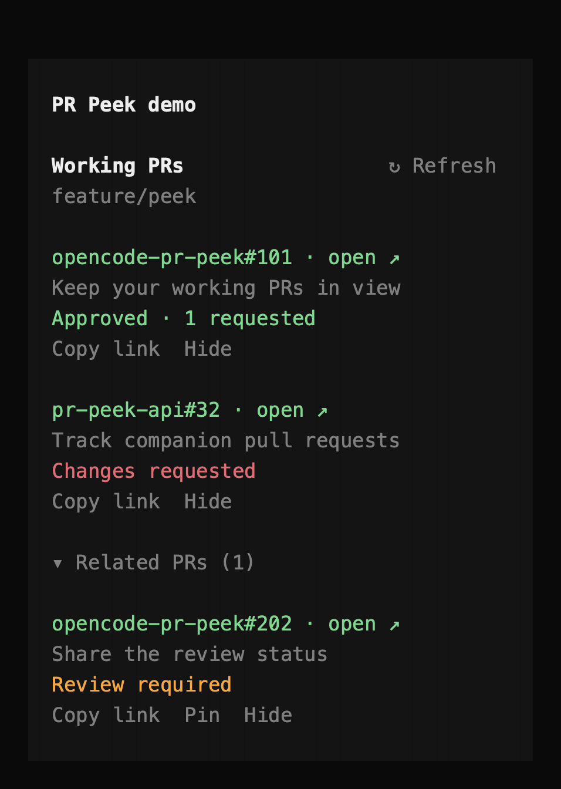

# opencode-pr-peek

Your work's pull requests, clickable at the top of the OpenCode V2 sidebar. Companion PRs created during the session appear with the branch's PRs. Other mentions stay under collapsed **Related PRs**.



Demo captured from OpenCode 2.1.4 with synthetic PRs. No private work appears in the image.

Open and draft PRs also show their code-review status. The status comes from GitHub's aggregate review decision, not a guess based on the latest comment:

- **Approved**: GitHub reports approval.
- **Changes requested**: GitHub reports requested changes.
- **Review required**: GitHub still requires review.
- **Awaiting review**: no aggregate decision exists, but review requests are outstanding.
- **No review decision**: GitHub reports no aggregate decision or outstanding requests.
- **Review unavailable**: the review lookup failed. The PR link still works.

Outstanding requests appear separately, such as **Approved · 1 requested**. A team request counts as one request. Approval does not mean CI passed, conflicts are resolved, or merging is allowed. Review status refreshes with PR status. Closed and merged PRs omit the review line.

## Requirements

- OpenCode **2.1.4**. Verified against this release; newer releases need checking because OpenCode supplies the Effect runtime.
- Git and an authenticated [GitHub CLI](https://cli.github.com/): `gh auth login`.
- A local checkout accessible from the machine running the terminal UI. This does not execute Git on a remote OpenCode server.
- Clipboard: macOS `pbcopy`, Windows `clip.exe`, or Linux `wl-copy` / `xclip`. Local Linux browser opening uses `xdg-open`; SSH and Herdr use terminal hyperlinks instead.

## Install locally

Run `npm ci` in this project. OpenTUI’s development dependencies require Bun >=1.3.14 or Node >=26.4.0 for UI tooling; core tests also run on Node 24.

Add the absolute project directory to the existing `plugins` array in `~/.config/opencode/cli.json` (or `$XDG_CONFIG_HOME/opencode/cli.json`). Preserve your other settings:

```json
{
  "$schema": "https://opencode.ai/v2/cli.json",
  "plugins": ["/Users/magic-bri/dev/opencode-pr-peek"]
}
```

OpenCode reloads valid CLI configuration changes automatically. Use `/reload` if needed. Keep the sidebar enabled (`session.sidebar: "auto"`) and the terminal wide enough to display it.

The root `tui.ts` is intentional: OpenCode’s local-directory loader discovers that entrypoint. The package also exposes `./tui` for package-based loading. This project is not published to npm yet.

## Customize

Use an object entry in `cli.json` to set options:

```json
{
  "$schema": "https://opencode.ai/v2/cli.json",
  "plugins": [
    {
      "package": "/Users/magic-bri/dev/opencode-pr-peek",
      "options": {
        "compact": false,
        "showBranch": true,
        "showTitle": true,
        "showCopyLink": true,
        "showSessionPRs": true,
        "maxVisiblePRs": 3,
        "localRefreshMs": 5000,
        "remoteRefreshMs": 30000,
        "colors": {
          "merged": "#a78bfa"
        }
      }
    }
  ]
}
```

| Option            | Default | Behavior                                                                    |
| ----------------- | ------- | --------------------------------------------------------------------------- |
| `compact`         | `false` | Removes blank rows. Puts the title on the PR-number line.                   |
| `showBranch`      | `true`  | Shows the current branch name.                                              |
| `showTitle`       | `true`  | Shows each PR's title.                                                      |
| `showCopyLink`    | `true`  | Shows the clickable copy action. `/pr-copy` works when hidden.              |
| `showSessionPRs`  | `true`  | Includes PR references from the session's history.                          |
| `maxVisiblePRs`   | `3`     | Shows 1 to 20 PRs per section before **Show more**.                         |
| `localRefreshMs`  | `5000`  | Checks the branch every 1,000 to 3,600,000 milliseconds.                    |
| `remoteRefreshMs` | `30000` | Refreshes GitHub and session history every 5,000 to 3,600,000 milliseconds. |
| `colors`          | `{}`    | Overrides `open`, `draft`, `merged`, or `closed` with a `#RRGGBB` value.    |

Open PRs use the theme's success color. Drafts use muted text. Merged PRs use the accent color. Closed PRs use the error color. Omitted overrides follow theme changes. Invalid values show a warning and use that setting's default.

## Use

- Click a PR number **or title** to open it in your default browser. In Herdr, use **Ctrl+click** to open the terminal hyperlink on the Herdr client computer instead.
- Click **Copy link** to copy its URL.
- Click **Refresh**, or use `/pr-refresh`.
- Use `/pr-open` or `/pr-copy` from the prompt. Multiple PRs open a searchable chooser.
- Expand **Related PRs**, then click **Pin** to move one into Working PRs.
- Click **Hide** to remove a PR from both sections. Click **Restore hidden PRs** to bring it back.
- Click **Unpin** to remove a manual pin. Branch-linked and session-created PRs still count as working PRs.
- `/pr-pin`, `/pr-unpin`, `/pr-hide`, and `/pr-restore` provide the same actions without a mouse.
- The command palette includes these **PR Peek** actions. No keyboard shortcuts are claimed by default.

### SSH and Herdr

PR numbers and titles carry standard terminal hyperlinks (OSC 8). With Herdr running on your Mac and connected to this computer through a saved SSH machine or `herdr --remote`, **Ctrl+click** opens the PR in your Mac's browser. A plain click or `/pr-open` shows the full clickable URL and instructions instead of launching a browser on the remote host. Other SSH terminals use their own open-link gesture.

PR Peek detects Herdr using `HERDR_ENV=1` or `TERM_PROGRAM=herdr`, and SSH using `SSH_CONNECTION`, `SSH_CLIENT`, or `SSH_TTY`. Herdr always uses terminal hyperlinks because a persistent pane cannot reliably tell where its current client is running. If you SSH first and then run the Herdr client on the remote host, Herdr's opener also runs there; run Herdr on your Mac with remote attach for Mac-side opening. Plain SSH without Herdr depends on the Mac terminal's OSC 8 support. Clipboard commands are unchanged and still run on the machine hosting the TUI.

Open/draft PRs appear first, newest updated first. Merged/closed PRs follow them. Each section initially shows three, with **Show more** for the remainder. GitHub results are paginated.

**Working PRs** includes the current branch's PRs, PRs created during this session, and your manual pins. Creation requires a successful direct `gh pr create` call from the `shell` tool (or the legacy `bash` tool) with exit code zero and one PR URL as its output. Leading environment assignments are supported, including `GH_TOKEN="$(gh auth token --user work-account)" gh pr create ...`. Assignment values are only parsed, never evaluated. An assistant saying "created" is not enough. Compound shell commands and other creation tools are not inferred. Pin those PRs manually.

**Related PRs** contains other references from user messages and assistant text. It is collapsed by default. Raw tool output, reasoning, commit history, diffs, and bulk GitHub results do not add related PRs. The sole tool-output exception is the confirmed creation result described above.

References can be URLs, `owner/repo#123`, `owner/repo #123`, or `PR #123`. A Markdown link's target determines its repository; its label is not scanned twice. A bare `#123` uses an explicit identity found elsewhere in the session if there is exactly one. Otherwise, it needs PR context such as "merge #123" before using the checkout's repository. Ambiguous bare numbers and numbered review points are ignored. GitHub's pull request endpoint confirms candidates, so issues do not appear as PRs.

Rows show repository names, such as `billing-vcc#32`. Choosers show the full owner/repository. PR identity always uses the full URL, so matching numbers in different repositories remain separate.

Pins and hidden choices use OpenCode's durable plugin storage, keyed by session ID. They survive closing sessions, reopening the TUI, and plugin reloads. They do not affect other sessions. Hiding takes precedence over automatic classification and pinning. Restoring a hidden pin keeps its pin. Saved pin snapshots remain available while GitHub refreshes them.

Session history survives closing and reopening a session. On reopen, the plugin scans it again. After that, it rereads the latest page and fetches new pages at the configured interval. This catches messages that finish streaming after the first scan. Unavailable related PRs show a lookup error separately from the branch results.

Local branch changes are checked every five seconds. PRs refresh every thirty seconds, after a session execution finishes, on relevant branch events, and on manual refresh. Lookup subprocesses time out after fifteen seconds. Closing the sidebar/session or reloading the plugin cancels its work. Branch lookup does not depend on chat history. Session-created PRs and related references come from that session's history.

## Matching and limits

The viewed session’s directory determines the checkout, not the focused workspace. Remote selection follows `branch.<name>.pushRemote`, `remote.pushDefault`, the tracking remote, then `origin` (or the sole remote). When using the tracking remote, the remote-tracking branch name is used.

The repository's default branch does not automatically add Working PRs. For example, a session on `main` must not inherit old PRs whose source branch was also `main`. The default branch comes from GitHub, not a hard-coded name. Explicit session-created PRs and saved pins still appear. Pin an intentional PR from the default branch if you want it treated as working.

For a fork, PRs are queried in its parent repository. Matching includes the full head repository and branch to exclude other forks with identical branch names. PRs targeting unrelated repositories or targeting the fork itself are not aggregated. GitHub Enterprise hosts use the authentication already configured in `gh`.

When multiple `gh` accounts are authenticated on the same host, PR Peek tries the active account first. If that account cannot access the repository, it retries the other healthy accounts, preferring a login that matches the remote owner. The selected credential is used only by that repository's lookup commands; PR Peek does not change the globally active `gh` account or store tokens itself.

Detached HEAD, no PR, missing `gh`, authentication failures, and lookup failures are distinct states. Old links are cleared when the branch changes or a lookup fails rather than silently displaying an unrelated/stale PR.

No PR creation, CI automation, agent prompts, token storage, or background model calls.

## Development

```sh
npm ci
npm run check
```

GitHub Actions runs `npm ci` and `npm run check` on pushes and pull requests. CI uses Node 26.4.0 and read-only repository permissions. It checks formatting, TypeScript, and unit tests without GitHub credentials. The real TUI test below remains a separate local check; CI does not install or launch OpenCode.

### Real TUI smoke test (opt-in)

```sh
npm run test:tui
# Retain fixtures, command traces, terminal captures, and final sidebar screens:
npm run test:tui -- --keep
# Use a specific host binary:
npm run test:tui -- --opencode /path/to/opencode
```

Requires OpenCode **2.1.4**, Git, Python 3.9+, and installed project dependencies (`npm ci`). Supported harness platforms are macOS (`sandbox-exec`) and Linux (`unshare` with user/network namespaces enabled). The runner fails if network isolation is unavailable; it never falls back to an unsandboxed run. Linux support is not yet verified on a Linux host. Windows is not supported by this PTY harness.

The test launches the real TUI in a 160×45 pseudo-terminal and clicks sidebar controls. It checks branch PRs without chat history, cross-repository successful creation evidence, collapsed related PRs, repository-safe labels, browser/copy URLs, pin/hide/restore/unpin, durable reopening, session isolation, and default-branch exclusion of historical PRs (with and without creation evidence).

Each run generates a synthetic checkout and completed imported tool fixtures in a new temporary directory. It uses private HOME, XDG config/data/state/cache, and database storage, with `--standalone` on every OpenCode invocation. Fake `gh`, browser, and clipboard commands reject unexpected calls; no actual `gh pr create`, browser, clipboard, or model calls run. External networking is blocked by the OS sandbox; only the standalone server's loopback traffic is allowed. Updates/model-catalog fetching are disabled and provider/tool use is denied. No user configuration, GitHub credentials, or existing sessions are used or changed.

Successful runs remove only their own temporary directory unless `--keep` is supplied. Failures retain it and print its path for diagnosis (`*.screen.txt`, `*.ansi`, `commands.jsonl`, and `data/opencode/log/opencode.log`). Set `TMPDIR` before running to choose its parent. The fixtures are generated afresh; no personal session history or machine-specific paths are required. `npm test` and `npm run check` remain unit-only and do not launch OpenCode.

- `src/command.ts`: injectable Effect command service; scoped subprocesses and typed errors.
- `src/github.ts`: checkout discovery and schema-validated GitHub lookup.
- `src/monitor.ts`: scoped refresh worker, throttling, cancellation, and branch isolation.
- `src/actions.ts`: browser and clipboard commands, without shell interpolation.
- `src/tui.tsx`: Solid/OpenTUI sidebar and command-palette actions.
- `src/options.ts`: schema-validated display, color, and refresh settings.
- `src/history.ts`: paginated session history and confirmed PR references.
- `src/references.ts`: repository-aware reference parsing without duplicate link-label matches.
- `src/classification.ts`: working/related groups and session-choice identities.

Effect and platform packages are pinned to **4.0.1**, matching OpenCode 2.1.4. OpenCode injects its own Effect modules; upgrading these independently can pass unit tests but fail inside the host. Validate dependency updates against the real TUI, not only TypeScript.

The lockfile overrides `seroval` to a patched release for development tooling. This plugin never deserializes Seroval data; OpenCode supplies Solid/OpenTUI at runtime.
